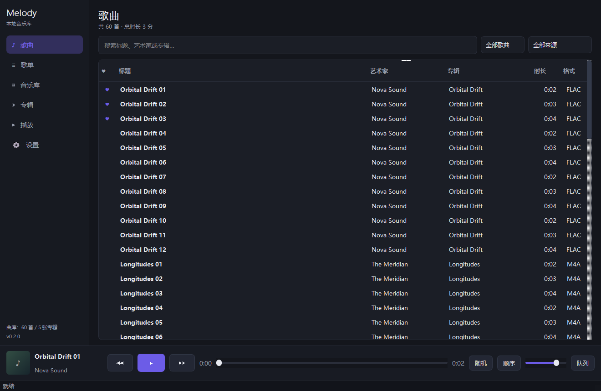

# Melody

本地音乐播放器。当前可用版本是 **PyQt5 原生桌面程序**（`desktop/`），不依赖浏览器、不联网。

重构后的界面由六个一级页面组成：**歌曲、歌单、音乐库、专辑、播放、设置**，底部是常驻播放条。
架构设计见 [docs/architecture-redesign.md](docs/architecture-redesign.md)。



## 快速开始

1. 双击项目根目录的 **`melody.cmd`**（无控制台窗口，直接开播放器）
2. 打开「音乐库」页 →「添加本地文件夹」选择音乐目录，自动扫描入库
3. 在「歌曲」页双击歌曲播放；底部播放条控制上一首 / 播放暂停 / 下一首 / 进度 / 音量
4. 「歌单」页新建歌单，在歌曲右键菜单里加入；「专辑」页按封面浏览
5. 「播放」页查看大封面、播放队列、随机与循环模式；「设置」页调整音量、主题色与数据
6. 点击左上角头像可换成本地图片；头像只是本机图片，不涉及账号或登录

遇到问题可双击 `dev.cmd`（带控制台）查看报错，崩溃信息写入 `%APPDATA%\Melody\crash.log`。

## 当前功能

**六个页面**

- **歌曲**：全部歌曲表；搜索标题/艺术家/专辑（200ms 防抖）；筛选全部/收藏/最近播放；按来源过滤；
  点击列头排序（标题/艺术家/专辑/时长/格式）；双击播放；右键菜单（播放、加入歌单、收藏、定位文件）
- **歌单**：新建/重命名/删除；添加曲目、移除、上移/下移；播放全部；空歌单占位提示
- **音乐库**：音乐来源列表（本地文件夹启用/停用/移除、曲目数、目录存在性检测）；浏览方式入口；
  扫描进度与结果；曲库工具（歌曲/专辑/艺术家/总时长/失效统计，检查与清理失效文件，清理转码缓存，打开数据目录）
- **专辑**：封面墙 + 搜索；专辑详情（封面、艺术家、年份、曲目表、播放整张专辑）
- **播放**：大封面与曲目信息、收藏、进度拖动、传输控制、随机/列表循环/单曲循环、音量、当前队列列表
- **设置**：默认音量、启动恢复上次播放、默认播放模式与随机、强调色、ffmpeg 状态、缓存清理、版本信息

**个性化**

- 侧边栏头像框：点击更换图片（PNG/JPG/WebP/BMP/GIF），右键菜单或设置页可移除；
  头像居中裁剪为 512px 内的 PNG 存到数据目录，**只是本机头像，不涉及账号 / 登录 / 用户管理**

**播放与数据**

- 独立播放队列（展示顺序 ≠ 播放顺序），随机 / 顺序 / 列表循环 / 单曲循环，播放结束自动切歌
- 播放次数、最近播放、收藏、播放历史写入 SQLite；会话恢复（上次曲目与进度）
- 添加 / 移除音乐文件夹，增量扫描（size+mtime 未变不重复解析），自动清理消失文件
- 支持 mp3 / flac / wav / ogg / oga / opus / m4a / aac / wma / ape / wv / aiff / aif / m4b / dsf / dff：
  元数据用 `ffprobe` 解析；QtMultimedia 原生不支持格式先用 `ffmpeg` 转码为 WAV 缓存后播放
- 内嵌封面提取与缓存；深色主题、可换强调色
- 音乐来源可插拔：本地文件夹与 WebDAV 远程库均已实现（来源登记、DPAPI 凭据、连接测试、
  扫描、封面、远程播放），远程播放经本地 127.0.0.1 代理并透传 Range；
  细节见 [docs/remote-library-interface.md](docs/remote-library-interface.md)

## 目录

```
desktop/
  run.py                     启动入口
  melody_app/
    app.py                   装配：数据库 → 仓储 → 服务 → 播放控制器 → AppContext
    main.py                  参数解析、崩溃日志、QApplication
    config.py                路径与音频格式白名单
    core/
      models.py              Song / Album / Playlist / Source / LibraryStats
      db.py                  SQLite schema v2 + v1→v2 自动迁移（备份 .v1.bak）
      repositories/          songs / albums / playlists / sources / settings
      sources/               MusicSource 抽象 + local / webdav（含本地 Range 代理）
      credentials.py         Windows DPAPI 凭据存储
      profile.py             本地头像图片处理（裁剪 / 保存 / 删除）
      library/               ffprobe 封装、本地/远程扫描线程、LibraryService
      playback/              AudioEngine（QMediaPlayer + 转码）、PlayQueue、PlaybackController
    ui/
      app_context.py         页面与业务之间的唯一通道（信号 + 仓储）
      main_window.py         外壳：左侧导航 + 六页 QStackedWidget + 播放条
      navigation.py  theme.py  player_bar.py  song_actions.py
      widgets/               SongTableView / CoverLabel / AvatarButton / Card / PageHeader / EmptyState
      pages/                 songs / playlists / library / albums / player / settings
tests_py/                    Python 自动化测试（unittest）
docs/
  architecture-redesign.md   六页面重构设计
  remote-library-interface.md  WebDAV 远程库接口与实现清单
  screenshots/               各页面截图
```

## 测试

```powershell
python -m unittest discover -s tests_py -v
```

覆盖：v2 建表与 v1→v2 迁移、搜索/排序/筛选、收藏与统计、专辑聚合、歌单增删改、
设置读写、播放队列（随机/循环/增删）、播放控制器（播放记录/自动切歌/会话恢复）、
扫描入库与增量扫描（扫描测试需要系统 ffmpeg）。

## 打包（Windows，自带 ffmpeg）

先获取代码（已在本地仓库的话跳过）：

```powershell
git clone https://github.com/whyeinstein/melody.git
cd melody
```

以下命令都在仓库根目录执行。打包版不依赖用户安装 Python 或 ffmpeg，提供两种模式：

| 模式 | 命令 | 产物 | 说明 |
| --- | --- | --- | --- |
| **onedir**（默认） | 双击 `scripts\build-exe.cmd`，或 `... build-exe.ps1` | `dist\Melody\Melody.exe` + `_internal\`（约 411 MB） | 启动快，适合日常使用 |
| **onefile**（单文件） | 双击 `scripts\build-onefile.cmd`，或 `... build-exe.ps1 -Mode onefile` | 单个 `dist\Melody.exe`（约 165 MB） | 便于分发；每次启动需先解压到临时目录，会慢几秒 |

步骤：

1. 安装打包依赖（Python 3.10+）：
   ```powershell
   python -m pip install PyQt5 pyinstaller
   ```
   脚本会优先使用仓库里的 `.cache\pydeps`（开发用的解包目录），没有则使用当前 Python 已安装的 PyInstaller；
2. 准备 ffmpeg 的 bin 目录（含 `ffmpeg.exe`、`ffprobe.exe`）：
   默认读取 `MELODY_FFMPEG_DIR`，否则用 `D:\tool\ffmpeg-7.0.2-full_build\bin`，可用 `-FfmpegDir` 覆盖，例如：
   ```powershell
   powershell -ExecutionPolicy Bypass -File scripts\build-exe.ps1 -Mode onefile -FfmpegDir "D:\ffmpeg\bin"
   ```
3. 双击 `scripts\build-exe.cmd`（onedir）或 `scripts\build-onefile.cmd`（单文件）。

程序查找 ffmpeg 的顺序：`MELODY_FFMPEG_DIR` → 打包目录（onefile 为解压目录）→ `vendor\ffmpeg\bin` → `%ProgramFiles%\ffmpeg\bin` → `PATH`。

单文件版每次启动都要把约 400 MB 依赖解压到临时目录（PyInstaller 机制），启动会慢几秒；
如果只是自己用，建议用 onedir 版。想减小体积可以换用更小的 ffmpeg 发行版（如 essentials build）。
打包成功后 `dist\` 目录不进版本库，可以直接把 exe（onedir 则是整个文件夹）复制到任意位置运行。

排查启动问题时可以用控制台调试版：

```powershell
$env:MELODY_CONSOLE = "1"
python -m PyInstaller packaging\melody.spec --noconfirm --clean --distpath dist
# 输出 dist\MelodyDebug\MelodyDebug.exe（带控制台）
```

## 关于 Electron 版本（已弃用）

`src/` 下保留了一套 Electron + React 实现（功能更完整，含专辑/艺术家视图、队列抽屉、主题等），
但在本机 Windows 10 Enterprise 25H2（build 26200）上 **Electron/Chromium 进程启动即崩溃**
（`0xc0000003`/`0xc0000005`，换 38/40/42/44 版本、关沙箱、关 GPU 均无效），因此改用原生 Qt。

`src/` 的代码与构建配置保留，供其他机器或系统修复后继续使用。

## 后续计划

1. 远程库体验补全：离线置灰、远程转码缓存复用、标签编辑
2. 歌单拖拽排序
3. 歌词（.lrc 与内嵌）显示
4. 系统托盘、全局媒体键、迷你模式
5. 专辑/艺术家更多元数据（风格、年份筛选）、封面墙虚化背景
6. 安装包（Inno Setup / NSIS）与自动更新
